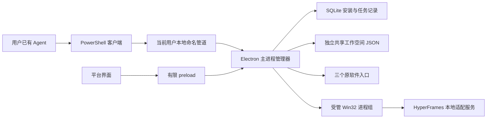

# 从独立工具到聚合工作台

## 产品边界

MediaHub 是已有 Agent 的本地工具工作台。它管理工具和共享工作空间，把原来分别安装、分别接入的工具整理成可按需安装的能力。平台不内置另一个通用 Agent，也不改变用户已有 Agent 的配置。

首版工具目录只保存结构化数据、版本、发行地址、校验值、能力和入口。主进程不从目录动态加载工具代码。旧工具在外部独立运行，HyperFrames 通过受管子进程运行。

## 同一条管理路径

界面和 Agent 共享清单、状态、安装、项目、素材、能力调用、任务取消、成果登记。先受理并记录任务，再报告执行进度，最后依据真实工具回执记录完成、失败、取消或中断。Agent 操作不固定创作顺序；首次接入只读查询，后续依据用户任务和已有授权操作。

命名管道限制当前 Windows 用户，拒绝远端连接，限制消息大小。辅助程序只转发结构化消息并维护 Win32 Job；父进程退出时回收受管子树。工具无法通过主界面注入主进程代码。

## 两种接入方式

旧工具保持安装目录、业务数据、账号与本地服务。平台核验原发行包，等待安装进程结束，再核验实际程序身份和版本。原软件更新及卸载入口明确标明管理归属；平台不伪造操作完成状态。

HyperFrames 独立组件先下载到缓存并校验，再解包到暂存版本目录。空闲检查、逐文件校验、暂存健康检查、激活、重新读取健康状态依次执行。失败时恢复原 active 指向，重新核验旧版本。预览窗口或渲染占用时不切换组件。

平台自身版本和各组件版本分别记录。工具目录采用 Ed25519 签名及单调递增序号；缓存损坏重新下载，目录签名失败或版本倒退拒绝应用。更新源是公开发行资产，平台程序更新由 electron-updater 单独处理。

## 共享工作空间

程序、平台数据与工作空间互不重叠。工作空间 JSON 是项目、素材、成果的可携带元数据；SQLite 是可重建索引以及操作事务记录。素材登记复制到共享空间，保留来源；进入 HyperFrames 工程后继续记录原素材 ID。成果索引引用项目渲染目录中的实际文件。

不自动迁移旧软件数据库和登录资料。后续逐工具补齐完整管理接口、组件化、功能覆盖和恢复验收，再考虑收敛独立桌面发行。

## HyperFrames 执行与隔离

固定上游 0.8.151，独立 Node 24.21.0、Chrome headless shell 152.0.7977.30、FFmpeg / FFprobe 8.1.1。使用本地模板、字体、GSAP 与运行文件，不运行上游 init 的在线下载、全局 Skill 安装、自动更新或遥测路径。

适配器使用 Producer 的结构化任务、进度与取消接口，每次渲染有独立 Win32 Job。仅在实际渲染成功且 FFprobe 检查 H.264、8 位、指定尺寸与 30fps 通过后登记成果。先落盘任务，再执行；结果未知时只查询，不重放。

平台页面、Studio 和生成内容分别使用独立来源与会话。Studio 身份凭据只在主进程内存与对应隔离会话使用，不写入公共任务结果。生成 HTML 采用独立无特权来源、内容安全策略和浏览器隔离；远端页面也不拥有平台接口。

关闭窗口保留托盘与任务。明确退出等待完成；选择取消时必须确认任务进程停止。异常退出后核对记录和文件，标记未知任务中断。卸载组件只删除组件程序和安装记录，保留用户工程、素材及成果。
